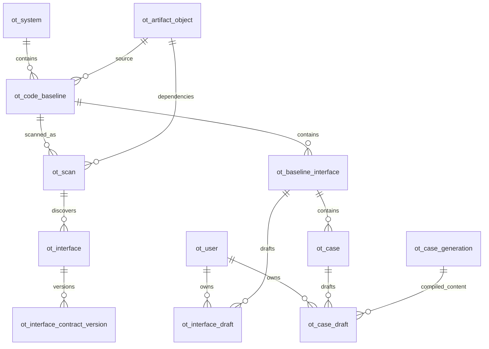

# OpenTest 共享基准与 Case 发布开发计划

2026-10-21。本文把已定稿的需求转为数据结构、表设计、接口、迁移和开发任务。本文中的新增字段、接口和模块均为计划内容，尚未实施；本轮不修改运行代码、数据库或存储配置。

本期交付范围为：强制公司登录、固定代码基准共享、接口知识与 Case 的个人草稿及显式发布、QA/UAT 选择、覆盖增强详情与重试、RustFS 材料共享和历史补传。TravelWorkOS 的完整页面嵌入及替换 Agent 底座留在后续阶段，本期不实现一套新的 Agent 框架。

## 1 设计依据与现有结构

以仓库当前工作树为开发起点，保留已有但尚未提交的代码变更。实现时先核对这些变更归属，不回退、覆盖或顺带重构。`AGENTS.md` 开头仍称 simplify-java-system-onboarding 未归档，但指定归档目录及 tasks 已记录其于 2026-10-10 归档；开工准备时校正该失效交接，不能按它继续旧变更。coverage.py、coverage_assistance.py 等本期会触及的文件已有未提交修改，先保存起始差异和归属，再叠加本期实现。

| 现有能力 | 当前结构 | 本期变化 |
| --- | --- | --- |
| 系统和源码选择 | `ot_system.system_json.source_version`、`latest_scan_id` | 系统身份保留；个人查看选择不再写这两个共享字段 |
| 不可变扫描 | `ot_scan`，含 manifest 和工具包 | 增加代码基准、扫描作者、固定依赖材料关联 |
| 扫描接口和契约 | `ot_interface`、`ot_interface_contract_version` | 保留不可变内容，另建按基准的当前发布指针及个人草稿指针 |
| 知识正文 | `ot_knowledge_node/edge` 当前按系统覆盖写 | 接口知识改为随契约版本固定；旧表保留历史和非接口用途 |
| Case 生成 | 一条 `ot_case_generation` 包含多个模板和可执行 variants | 保留整批不可变生成物，增加单个 Case 的稳定身份及发布指针 |
| 工作流 | `ot_workflow_record` 保存任务、handoff、问答、回执 | 增加员工、基准、环境查询列；继续复用工作流 JSON |
| 执行 | `ot_execution` 保存去重、工作台归属、摘要和完整结果 | 增加员工、基准及精确 Case 选择范围 |
| 覆盖增强 | 工作流 JSON 加 coverage 执行记录 | 扩展 UAT、重试尝试和 S3 引用，不另建覆盖专表 |
| 源码和依赖 | 源码依赖本机绑定，依赖 JAR 依赖本机 Maven 缓存 | 冻结并共享实际文件，其他机器直接物化本地缓存 |
| 数据库初始化 | `install_schema()` 只执行 `CREATE TABLE IF NOT EXISTS` | 增加本次显式升级及回填命令，不能依靠初始化自动升级旧表 |

当前 schema 有 13 张业务表，本方案新增 7 张、调整 5 张表的物理字段，其余按需调整读取和写入语义。字段设计沿用现有 MySQL、严格 Pydantic 模型和 JSON 聚合方式。

代码依据见文末，不读取或修改旧归档方案来代替当前实现。

## 2 必须保持的业务约束

1. 所有业务入口先取得服务端验证的员工身份；页面、API、Agent 工具遵循同一规则。
2. 员工归属与执行工作台分开：`owner_user_id` 表示谁的内容或任务，`owner_workspace_id` 表示哪台机器负责执行和恢复。
3. 用户选择的是代码基准；同一基准可有多次内部扫描，但页面不增加扫描修订选择器。
4. 新基准只复制业务背景和术语，全量生成接口知识，Case 为空；同一基准发布更新才做影响判断。
5. 扫描完成、知识生成完成、Case 编译成功，都不自动推进共享发布指针。
6. 每个接口、每个 Case 只有一个当前共享指针。旧内容仍保存，但不能通过列表、精确 ID、任务结果或下载链接重新打开。
7. 全部发布只处理当前系统、当前基准、本人的对应可发布草稿，不受分页影响；接口和 Case 分开发布。
8. 任务启动时固定员工、基准、扫描、知识引用和环境；后续页面切换不能改写任务输入。
9. S3 保存实际材料，默认不过期；MySQL 不保存可供另一机器直接使用的绝对源码路径。
10. 本期不新增发布审批、角色管理、分布式任务框架、通用版本仓库或自动垃圾回收机制。

当前多人各自运行的方式采用可信组内协作：每台机器持有共享 MySQL 和 RustFS 凭据，RustFS 使用 HTTP。上述身份和可见性约束由 OpenTest 应用执行，不能阻止持有这些凭据的人直接读写数据库、对象存储或修改客户端；不宣称实现了数据库级人员隔离或传输加密。该边界不取消页面、API 和工具正常使用时的草稿隔离。上线时由组员停止旧客户端并升级，不能声称新应用可以技术封锁旧程序的裸数据库写入。

## 3 领域模型与关系

### 3.1 关系图



图中的关联是逻辑外键。本期沿用现有 schema 不声明数据库外键的方式，由应用事务校验同系统、同基准及引用存在性，不引入级联删除。

### 3.2 关键身份

| 身份 | 定义 | 不能替代它的值 |
| --- | --- | --- |
| `user_id` | 公司验证结果中的 `newWorkId`，原值规范化为字符串 | 姓名、本机目录、工作台 ID、前端自报工号 |
| `baseline_id` | 一套固定源码的稳定身份；新 Git 基准按系统加完整 commit 唯一 | 分支名、标签名、某次扫描 ID |
| `scan_id` | 一次不可变扫描，固定本次扫描实际使用的依赖 | 基准的最新扫描时间 |
| `baseline_interface_id` | 某基准内一个规范接口的稳定内部 ID | 每次重扫产生的 `interface_id` |
| `case_id` | 一个可独立发布、执行的子用例的稳定业务 ID | 标题、数组下标、会随内容变化的 `variant_id` |
| `generation_id + variant_id` | 某次编译产出的精确可执行 Case 内容 | 当前 Case 的可变发布指针 |
| `enhancement_id` | 一次增强尝试 | Case 业务 ID、一次模型会话 ID |

现有页面把模板称为测试场景，把 variant 称为子用例。本期“单个 Case 发布”落到可执行子用例；测试场景继续作为分组，一键全部发布覆盖所有符合条件的子用例。

### 3.3 严格模型

新增或扩展模型保持业务含义明确，不创建包含所有字段的通用 Context。

| 模型 | 主要字段 | 用途 |
| --- | --- | --- |
| `AuthenticatedUser` | `user_id`、`name`；展示值派生为 `name-newWorkId` | 服务端鉴权结果，不接受业务请求覆盖 |
| `CodeBaseline` | `baseline_id/system_id/source_commit/source_artifact_id/inherited_from_baseline_id/context_revision` | 顶部基准与源码共享 |
| `InterfaceKnowledgeRef` | `baseline_interface_id/interface_id/contract_revision` | 精确定位固定接口知识 |
| `InterfaceKnowledgeBundle` | 结构化知识节点、正文、必要关系、背景术语输入副本、源码证据 | 契约版本所需的完整知识内容 |
| `CaseItemBinding` | `case_id/variant_id/knowledge_dependencies` | Generation 内单项 Case 身份及依赖映射 |
| `CaseSelection` | `case_id/generation_id/variant_id` 列表 | 精确执行、结果裁剪和覆盖尝试 |
| `PublicationRequest` | `request_id/scope/items`；scope 为 all 或 selected | 单项与全部发布共用接口 |
| `PublicationItemResult` | `item_id/status/reason_code/message/publication_revision` | 已发布、冲突、依赖不满足等逐项结果 |
| `DeploymentConfirmation` | `baseline_id/source_commit/environment_id/user_id/confirmed_at` | 记录实际确认范围；用户和时间由服务端补齐 |
| `StoredArtifactRef` | `artifact_id` | 对象存储文件关联，业务模型不携带凭据或预签名地址 |

`CaseItemBinding` 必须在新 Generation 最终保存时建立，后续不能修改原 Generation。编辑已有 Case 时明确传入 `case_id`；无法证明是同一个 Case 的重新生成项，创建新的 `case_id`，不凭相似标题覆盖旧内容。

## 4 新增表设计

### 4.1 通用约定

- 引用现有系统、扫描、Generation 的字段沿用 `VARCHAR(240) CHARACTER SET ascii COLLATE ascii_bin`，下表简称 ID240。
- 新对象 ID 使用 `VARCHAR(64) CHARACTER SET ascii COLLATE ascii_bin`，简称 ID64；由服务端分配，不用业务内容哈希代替身份。
- 员工 ID 使用 `VARCHAR(128) COLLATE utf8mb4_bin`，简称 USER128，值为 `newWorkId`，区分大小写，不擅自转为小写。
- 状态使用 ASCII `VARCHAR` 加领域模型枚举校验；不增加数据库 ENUM 迁移负担。
- 时间统一 `DATETIME(6)`，保存 UTC；普通文本及 JSON 保持 utf8mb4。
- 所有新增表使用 InnoDB 和 DYNAMIC 行格式。下面字段、索引和约束共同构成建表契约。

### 4.2 ot_user 员工身份

| 字段 | 类型及约束 | 含义 |
| --- | --- | --- |
| `user_id` | USER128，主键 | 经公司验证的 newWorkId |
| `name` | VARCHAR(240)，非空 | 公司返回的姓名，可更新 |
| `created_at` | DATETIME(6)，非空 | 首次登录时间 |
| `last_login_at` | DATETIME(6)，非空 | 最近成功登录时间 |
| `updated_at` | DATETIME(6)，非空 | 姓名等资料更新时间 |

展示标识在读取时拼接，不重复保存 `display_name`。登录只更新资料，不变更已有任务和草稿的 user_id。workId 只在接入核对时读取，不因临时核对增加永久字段。本表不保存公司 access token、refresh token、密码或浏览器 Cookie。

### 4.3 ot_code_baseline 代码基准

| 字段 | 类型及约束 | 含义 |
| --- | --- | --- |
| `baseline_id` | ID240，主键 | 稳定基准身份 |
| `system_id` | ID240，非空 | 所属系统 |
| `source_kind` | VARCHAR(24)，非空 | GIT；旧数据隔离使用 LEGACY |
| `source_commit` | VARCHAR(64) ASCII，可空 | GIT 必须为完整 commit；历史非 Git 为 NULL |
| `selected_revision` | VARCHAR(500)，非空，默认空串 | 首次创建时选择的 branch、tag 或 commit，页面称“创建来源” |
| `source_artifact_id` | ID64，可空 | 已完成共享的源码包 |
| `inherited_from_baseline_id` | ID240，可空 | 一次性继承来源 |
| `context_json` | JSON，可空 | 本基准的业务背景及术语，复用现有结构 |
| `interview_json` | JSON，可空 | 与本基准背景相关的人工访谈内容 |
| `questions_json` | JSON，可空 | 背景和术语的问题及答案；不复制旧接口知识 |
| `context_revision` | BIGINT UNSIGNED，非空，默认 0 | 背景编辑并发版本 |
| `created_by_user_id` | USER128，可空 | 新记录必填；历史未知不冒认 |
| `updated_by_user_id` | USER128，可空 | 最近背景修改人 |
| `created_at/updated_at` | DATETIME(6)，非空 | 创建及修改时间 |

索引：主键 `baseline_id`；唯一索引 `(system_id,source_commit)`；列表索引 `(system_id,created_at)`。同系统同 commit 再扫描复用基准；其他 branch/tag 解析到该 commit 时，本次输入保留在任务中用于结果说明，不覆盖首次创建来源，不增加来源列表表。LEGACY 的 commit 使用 NULL，不能把所有旧空 commit 合并成一个基准。

新建基准在源码包完成共享后绑定 `source_artifact_id`，其他用户即可看到基准条目。历史迁入的已有共享成果即使源码材料缺失，也展示对应基准并标注“材料待补齐”；缺失文件只阻止实际依赖这些文件的重扫、生成或增强，不整条隐藏。是否已有接口发布通过发布指针查询，不增加重复的“已发布”总状态。扫描、资源验证、知识生成状态由各自工作流呈现，不挤入一个基准成功或失败字段。

不新增全局 `current_baseline_id` 或 `latest_scan_id`。背景修改采用 `context_revision` 并发检查；任务和接口知识版本保存实际消费的背景输入，后续背景修改不改写旧产物。

### 4.4 ot_artifact_object 共享文件

| 字段 | 类型及约束 | 含义 |
| --- | --- | --- |
| `artifact_id` | ID64，主键 | 固定文件身份 |
| `artifact_kind` | VARCHAR(32)，非空 | SOURCE、DEPENDENCIES、DEPLOYED_BINARY、COVERAGE_EXEC、COVERAGE_REPORT |
| `bucket` | VARCHAR(63) ASCII，非空 | S3 桶名 |
| `object_key` | VARCHAR(1024) ASCII，非空 | 不可覆盖的对象 key |
| `byte_size` | BIGINT UNSIGNED，非空 | 实际文件字节数 |
| `content_type` | VARCHAR(120)，非空 | 文件类型 |
| `created_by_user_id` | USER128，可空 | 上传人；历史未知允许为空 |
| `created_at` | DATETIME(6)，非空 | 上传完成时间 |

索引：主键 `artifact_id`；唯一索引 `(bucket,object_key)`。不新增过期时间、清理状态或自定义内容哈希。

记录仅代表已上传完成且通过读取检查的文件。上传过程复用任务阶段记录；失败不创建有效业务引用。对象存储和数据库不存在共同事务，未绑定的已上传对象按任务原引用检查后重用，不能谎报成功，也不自动删除。

本表不决定业务可见性。材料由后台通过所属基准、扫描或当前员工的覆盖任务读取，不新增通用 artifact 下载 API；现有覆盖报告下载继续走专用业务入口并校验员工和当前内容。

### 4.5 ot_baseline_interface 基准接口及当前发布

| 字段 | 类型及约束 | 含义 |
| --- | --- | --- |
| `baseline_interface_id` | BIGINT UNSIGNED，自增主键 | 同一基准内稳定接口身份 |
| `baseline_id` | ID240，非空 | 所属基准 |
| `operation_id` | VARCHAR(500)，非空 | 现有规范接口标识 |
| `current_interface_id` | BIGINT UNSIGNED，可空 | 当前共享内容来自哪个扫描接口 |
| `current_contract_revision` | INT UNSIGNED，可空 | 当前共享契约及知识版本 |
| `publication_revision` | BIGINT UNSIGNED，非空，默认 0 | 本接口发布并发版本 |
| `availability` | VARCHAR(24)，非空 | UNPUBLISHED、AVAILABLE、REMOVED |
| `published_by_user_id` | USER128，可空 | 当前发布人；历史导入可空 |
| `published_at` | DATETIME(6)，可空 | 当前发布时间 |
| `created_at/updated_at` | DATETIME(6)，非空 | 行创建及修改时间 |

索引：唯一索引 `(baseline_id,operation_id)`；列表索引 `(baseline_id,availability)`。两个 current 字段必须同时为空或同时有值，并指向同基准的合法契约版本。

重扫产生新的 `interface_id`，但不改变 `baseline_interface_id`。未发布接口仅能由对应本人草稿投影看到，不能因为稳定接口行已存在，就向其他人泄漏接口列表。

删除接口也是显式发布的变化。只有完整扫描或明确删除操作才能形成删除草稿；不能因部分扫描漏项自动删除共享接口。删除后清除当前内容指针并设置 REMOVED，旧版本继续在原版本表保留。

### 4.6 ot_interface_draft 个人接口草稿指针

| 字段 | 类型及约束 | 含义 |
| --- | --- | --- |
| `baseline_interface_id` | BIGINT UNSIGNED，联合主键 | 稳定接口身份 |
| `owner_user_id` | USER128，联合主键 | 草稿员工 |
| `interface_id` | BIGINT UNSIGNED，可空 | 草稿使用的扫描接口 |
| `contract_revision` | INT UNSIGNED，可空 | 草稿契约及知识版本 |
| `change_kind` | VARCHAR(16)，非空 | UPSERT 或 REMOVE；REMOVE 不要求新契约 |
| `expected_publication_revision` | BIGINT UNSIGNED，非空 | 草稿基于的共享发布版本 |
| `draft_revision` | BIGINT UNSIGNED，非空，默认 0 | 草稿自身并发版本 |
| `status` | VARCHAR(24)，非空 | BUILDING、READY、INCOMPLETE、PUBLISHED |
| `updated_at` | DATETIME(6)，非空 | 最近更新 |

索引：联合主键 `(baseline_interface_id,owner_user_id)`；索引 `(owner_user_id,status)`。每人每接口保留一个当前草稿指针，旧内容仍在不可变契约及工作流中，不新增一个面向用户的草稿版本浏览器。

BUILDING、问答和失败详情复用已有工作流；此表只服务草稿入口及发布判断。生成完成只推进本人的草稿指针，不更新共享 current 指针。

UPSERT 的 interface_id 与 contract_revision 必须成对存在或为空，READY/PUBLISHED 必须指向有效的完整契约及知识；REMOVE 可以没有新契约。生成完成更新草稿时校验启动时的 draft_revision，不能让旧任务覆盖同员工的新编辑。PUBLISHED 行不再作为个人草稿内容入口。

### 4.7 ot_case 单项 Case 及当前发布

| 字段 | 类型及约束 | 含义 |
| --- | --- | --- |
| `case_id` | ID240，主键 | 稳定单项 Case 身份 |
| `baseline_interface_id` | BIGINT UNSIGNED，非空 | 目标接口及基准 |
| `current_generation_id` | ID240，可空 | 当前共享内容所在 Generation |
| `current_variant_id` | VARCHAR(64) ASCII，可空 | 当前共享可执行子用例 |
| `publication_revision` | BIGINT UNSIGNED，非空，默认 0 | 单项发布并发版本 |
| `knowledge_dependencies_json` | JSON，可空 | 当前共享 Case 实际使用的知识引用集合 |
| `impact_status` | VARCHAR(32)，可空 | 当前共享内容的适用性：CURRENT、NEEDS_UPDATE、INTERFACE_REMOVED；未发布为 NULL |
| `impact_details_json` | JSON，可空 | 受影响接口、字段和中文原因 |
| `created_by_user_id` | USER128，可空 | 首次创建人；旧数据未知可空 |
| `published_by_user_id` | USER128，可空 | 当前发布人 |
| `published_at` | DATETIME(6)，可空 | 当前发布时间 |
| `created_at/updated_at` | DATETIME(6)，非空 | 创建及修改时间 |

索引：主键 `case_id`；索引 `(baseline_interface_id,impact_status)`；发布内容定位索引 `(current_generation_id,current_variant_id)`，供新 Case 查询定位当前内容。当前 generation 与 variant 必须同时为空或同时有值，且 variant 在该 Generation 中存在。两者为空表示尚未共享，impact_status 必须为空；两者有值才填写适用性，不另用 UNPUBLISHED 混合两个维度。

`knowledge_dependencies_json` 是当前发布的派生查询字段，必须从固定 Generation 的单项绑定生成，不能由页面单独编辑。原 Generation 不可变；接口更新只修改适用性和当前发布指针，不重写既有 DSL。

CURRENT 可正常执行；NEEDS_UPDATE 保留当前 Case 的查看入口及变化原因，执行前必须通过知识兼容检查，实质不兼容时要求更新；INTERFACE_REMOVED 不可执行。个人草稿可以使用本人尚未发布的接口知识进行生成和验证，但共享发布必须满足已发布知识依赖。发布状态与可执行性分别判断，不能把“自己可以测试”直接等同于“可以公开发布”。

### 4.8 ot_case_draft 个人 Case 草稿指针

| 字段 | 类型及约束 | 含义 |
| --- | --- | --- |
| `case_id` | ID240，联合主键 | 稳定 Case 身份 |
| `owner_user_id` | USER128，联合主键 | 草稿员工 |
| `generation_id` | ID240，非空 | 编译产物 |
| `variant_id` | VARCHAR(64) ASCII，非空 | 本草稿选中的子用例 |
| `expected_publication_revision` | BIGINT UNSIGNED，非空 | 编辑起点的共享版本 |
| `draft_revision` | BIGINT UNSIGNED，非空，默认 0 | 草稿并发版本 |
| `status` | VARCHAR(24)，非空 | READY、INCOMPLETE、PUBLISHED；构建进度保存在工作流 |
| `updated_at` | DATETIME(6)，非空 | 最近更新 |

索引：联合主键 `(case_id,owner_user_id)`；索引 `(owner_user_id,status)`；定位索引 `(generation_id,variant_id)`。通过 ot_case 和 ot_baseline_interface 关联当前系统及基准，不重复保存可推导的字段。

生成 READY/PARTIAL/BLOCKED 是编译结果，不是共享发布状态。可发布草稿必须具备可执行的精确 variant，并满足接口知识依赖条件。

首轮构建尚无 variant 时只保存工作流，不提前插入 Case 草稿行。编译产物固定后才建立单项草稿；已有 Case 再生成期间保留原草稿指针，完成时校验任务启动时的 draft_revision，晚完成任务不能覆盖同一员工在另一台机器的新编辑。没有有效 variant 的失败或阻塞结果继续通过本人工作流查看。

## 5 现有表调整

| 表 | 字段或语义变化 | 索引与约束 |
| --- | --- | --- |
| `ot_scan` | 新增 `baseline_id ID240 NULL`、`created_by_user_id USER128 NULL`、`dependency_artifact_id ID64 NULL` | 新增 `(baseline_id,generated_at)`；新扫描必须带基准和作者，历史无法关联保持空值且不进入新目录 |
| `ot_interface_contract_version` | 新增 `author_user_id USER128 NULL`、`knowledge_json JSON NULL` | 保留 `(interface_id,revision)` 主键；新知识 JSON 包含节点正文及必要关系，不另重复保存同一份正文列 |
| `ot_case_generation` | 新增 `baseline_id ID240 NULL`、`owner_user_id USER128 NULL`；`generation_json` 新增严格的 `case_bindings` | 新增 `(baseline_id,owner_user_id,created_at)`；新记录必填，原 generation 保持不可变 |
| `ot_workflow_record` | 新增 `baseline_id ID240 NULL`、`owner_user_id USER128 NULL`、`environment_id VARCHAR(120) NOT NULL DEFAULT ''` | 新增 `(baseline_id,owner_user_id,record_kind,created_at)`；保留原 workspace 和 revision 约束 |
| `ot_execution` | 新增 `baseline_id ID240 NULL`、`owner_user_id USER128 NULL`；完整载荷新增精确 `case_selection` | 新增 `(baseline_id,owner_user_id,environment_id,execution_kind,created_at)`；保留原 request 去重唯一键 |

迁移期间允许 NULL 是为了保留真实历史，不代表新写入允许匿名。新业务任务必须记录已验证员工；与基准有关的记录必须带 baseline_id；资源校验、测试执行和覆盖等环境相关操作必须带 qa/uat。登录、纯发布及其他不依赖环境的记录不虚构测试环境；工作流的空环境值仅用于此类操作。系统级管理任务无需伪造 baseline_id。

以下表不新增物理字段，但修改调用方式：

- `ot_system`：保留系统注册信息；旧 pin、latest scan、系统背景只用于受控迁移或兼容读取，不再决定新页面和新任务的版本。`workspace_revision` 继续用于已有缓存失效。
- `ot_interface`：`latest_contract_revision` 可以继续作为内部版本分配依据，不能当作共享发布指针。
- `ot_knowledge_node/edge`：不直接为新接口页面提供“系统最新知识”。新接口知识通过契约版本中的完整 bundle 读取，原表不删除。
- `ot_interface_relation`：公开依赖目录只投影当前可见接口，不能因扫描关系表存在私有接口就向他人返回。
- `ot_data_capability_version/ot_published_capability/ot_rule_revision`：保留已有固定版本语义，Case 继续冻结它实际使用的版本，不在本期重做其发布体系。数据函数草稿仍属于本人的 data_handoff；经现有真实试跑验证并调用发布入口后的函数按系统共享，可被其他基准按固定版本复用。不能把完整私有 Case、问答或一次性测试数据作为共享函数正文发布；生成草稿不等于函数已经共享。

### 5.1 任务与覆盖 JSON 增量

```text
TaskRecord / Handoff
  owner_user_id
  baseline_id
  environment_id
  source_scan_id
  interface_knowledge_refs[]
  case_selection[]                 # 有明确Case时固定
  owner_workspace_id / PID / process_start_marker   # 原有执行身份保留

CoverageEnhancement
  owner_user_id / baseline_id
  environment_id: qa | uat
  root_enhancement_id
  retry_of_enhancement_id
  retry_request_id
  deployment_confirmation
  case_selection[]
  baseline / verification         # 继续复用现有两次测量结构
  reused_stages                   # 对应来源尝试及材料引用，不复制业务结果

CoverageRawCapture
  exec_artifact_id
  deployed_binary_artifact_id
  source_artifact_id
  source_commit
  # 本次测量的实例、窗口和class ID校验结果保留于现有测量结构
```

不新增 coverage_task、gap、measurement、attempt 等表。覆盖尝试继续使用 `ot_workflow_record(record_kind=coverage_enhancement)`，报告继续使用 `ot_execution(execution_kind=coverage)`。

发布及重试回执也使用现有工作流表：record_kind 分别为 publication_request 和 coverage_retry_request，record_id 采用客户端为一次操作生成并在重发时保留的 UUID request_id。回执 JSON 固定员工、系统、基准、发布类型或增强 root、输入条目与结果；同 ID 携带不同范围或内容时返回冲突。作用域在载荷中严格校验，不把多个最大长度业务 ID 拼接到 record_id 中，也不新增回执表。

迁移读取器兼容旧 exec_base64 和 FrozenCoverageArtifact 定位，成功补传后转换为共享文件引用。新写入只写新结构，不能长期同时维护两套原始材料。

## 6 关键流程与事务

### 6.1 公司登录

复用已提供 Demo 的实际链路：请求公司登录策略，完成公司登录后返回本机，由 OpenTest 后端调用固定公司 HTTPS 用户接口核验，再取得 name、newWorkId 和 workId。

成功后以 newWorkId 更新或建立 ot_user。name 和 newWorkId 缺失时返回身份信息不完整，不能用姓名、机器或随机账号代替。公司凭据不写入业务表，不返回给 Agent 或普通业务页面。

本期采用后端内存会话和不透明随机会话标识，沿用 Demo 一小时有效期作为默认配置；服务重启后重新登录。会话不跨电脑复制，但登录同一员工后访问同一份个人数据。登录回调的一次性状态、关联验证、退出和失败不循环跳转保留 Demo 已有约束。正式应用配置和回调适配作为登录实施任务完成。

浏览器路径明确保留 Demo 的 Host 允许列表、HttpOnly/SameSite=Lax Cookie、精确 Origin 校验、会话绑定 CSRF token、一次性登录回调状态及成功登录后的会话轮换。依赖 Cookie 的业务写请求缺少或携带错误 CSRF、Origin 不匹配时拒绝；不能只依赖回环地址或 Cookie。MCP 使用独立 bearer 验证，不因缺少浏览器 Origin 或 CSRF 头误拒绝合法工具请求，也不能因带了无效 bearer 就绕过 Cookie 检查。

业务鉴权覆盖 `/api/v2` 业务路由和工具入口。只开放登录相关路由、必要静态资源及不含业务信息的存活检查。退出清理 OpenTest 会话，不自动登出其他公司应用。

后台任务保留创建时已授权的员工和输入，允许完成已经启动的任务；新的业务请求仍须有效登录。Agent 子进程使用服务端在登录后为既有任务签发的随机任务访问凭据，只允许该任务工具，不能据此开启其他任务。凭据通过受限本地运行配置或进程环境交给桥接进程，不进入提示词、URL或共享业务 JSON。现有回环地址和 task_id 限制不能代替鉴权。

用户直接从自己的 Codex 调用插件时，使用用户级本地凭据，不要求先有 task_id。登录成功后，OpenTest 签发绑定当前员工和本机会话的随机 bearer，原子写入当前操作系统用户可读的本地凭据文件；两个插件 MCP 脚本每次请求读取它并发送 Authorization 头。退出、过期、切换账号或服务重启使旧 bearer 失效；缺少凭据提示先在 OpenTest 登录，不接受调用者自报 owner_user_id。脚本继续限制回环地址，并把目前“unauthenticated loopback”的错误文案改为准确的“禁止 URL 内嵌账号密码”；原检查并不禁止 Authorization 头。用户 bearer 与任务 bearer 分别校验，不能把旧员工任务自动转属新登录员工。

两类凭据的有效期明确区分：用户 bearer 与浏览器会话使用同一到期时间，默认登录后 1 小时，不因工具调用自动续期。PyCharm 重启 OpenTest 服务后，即使本地文件还在，旧用户 bearer 也无效；页面和插件统一提示“OpenTest 登录已过期或服务已重启，请重新登录后再调用工具”。重新登录刷新本地凭据，插件下次请求读取新值，不要求重建 Codex 聊天。

任务 bearer 绑定已授权任务和当前服务实例，不随浏览器会话到期、退出或切换员工提前失效；它仅能继续原任务冻结范围内的工具调用，不能发起新任务、扩大范围或代替新的人工操作授权。任务完成、取消、达到既有执行超时或服务实例结束时，凭据失效。服务重启后不接受旧任务 bearer，也不允许外部调用者仅凭 task_id 换取新凭据；只有服务端按已有工作台、进程和任务恢复规则确认可恢复的既有任务，才为其受控执行重新签发任务凭据，不因此重放结果未知的业务请求。新的人工续跑或新任务仍要求有效用户登录，不增加长期刷新凭据机制。

### 6.1.1 登录接入依赖与验收条件

产品选择保持不变：newWorkId 作为员工归属，name-newWorkId 作为展示；这些依赖是实施资料与验收条件，不重新开启登录方案选择。

| 依赖 | 责任与落实内容 | 阻塞范围 |
| --- | --- | --- |
| 应用登记及本机回调 | OpenTest 实施负责人协调公司认证平台应用管理员、TravelWorkOS 登记维护方落实允许使用的应用登记和回调。Demo 当前借用 TravelWorkOS 登记，不能把样例可登录当作正式接入已获支持 | P1.3 真实接入验收及组内推广；不阻塞表结构、存储和受控测试开发 |
| 员工标识字段契约 | OpenTest 实施负责人协调员工目录维护方落实 newWorkId 的非空、唯一、长期稳定性和后续 TravelWorkOS 交接字段；实施者验证真实回包与同员工复登一致 | 导入真实员工归属及登录验收；不允许缺失时自动降级成 workId 或姓名 |

Demo 目前把 raw.id 映射为 workId，newWorkId 是可选返回字段，示例归属使用 workId。实施必须按本方案调整，不能直接复制 Demo 的归属代码并宣称 newWorkId 已得到验证。资料未具备时准确标记对应联调尚未通过，不伪造身份数据完成验收。

### 6.2 基准创建及共享源码

1. 鉴权并解析所选 revision 为完整 commit；只读取该 commit，不混入工作区未提交内容。
2. 按 `(system_id,source_commit)` 建立或复用基准；并发创建由唯一键确定同一身份。
3. 在数据库事务外准备、上传源码对象，检查可读后短事务绑定 source_artifact_id；绑定成功后基准对他人可见。
4. 扫描时冻结真实依赖 classpath，上传实际 JAR、必要 POM、源码附件和资源，并绑定本次 scan。
5. 生成接口草稿和完整知识，执行当前环境资源校验；结果分别记录。
6. 只更新当前员工的接口草稿，不自动发布。

同 commit 的源码包不被后续扫描覆盖。依赖包固定在 scan，而非 baseline：同 commit 重扫可能补齐依赖或解析到不同 SNAPSHOT，旧任务必须保留自己实际使用的依赖。

下载端按 artifact_id 缓存源码和依赖，并按包内相对路径 classpath 读取。读取冻结材料时不要求另一台机器拥有原 Git 权限、本地托管 tag、原 Maven 缓存或再次成功解析依赖。缓存解包继续校验路径边界，不能把相对路径解释为任意本机路径。

基准创建使用现有工作流记录各阶段输入和完成引用：源码上传、扫描与依赖材料、逐接口知识、指定环境资源校验。中断后提供“继续创建”，沿用已固定 commit、背景输入、scan 和本人任务归属；已上传且可读的对象不重传，完整扫描不重扫，已完成且输入未变的接口知识不重新生成，只补失败或缺失部分。资源校验单独记录，不因它失败撤销源码、扫描或知识成果。输入确已改变时才从受影响阶段重新处理，不把后来修改的工作区当作原任务输入。

续跑复用现有工作流回执和任务管理器，不建立新的阶段调度框架。同请求返回原结果，同一创建流程最多一个活动任务；远端仍运行或执行归属不明时不可直接接管。同员工换机器可从已上传材料继续已终止的流程；尚未上传且只在原机器的文件明确提示待补齐。续跑不自动发布接口或 Case。

### 6.3 接口和 Case 发布

单项与全部发布共用服务。全部发布先从数据库选出当前系统、基准、员工的可发布草稿，固定条目 ID、draft_revision 和 expected_publication_revision，写入既有工作流回执；不读取页面当前分页作为发布范围。生成中或不完整项作为未发布原因返回，不伪装成功。

批量发布先同步逐项短事务处理并直接返回汇总，不使用 TaskManager，不新增发布进度轮询接口。只有实测超出请求预算后才另行评估异步化。每项流程为：

1. 默认只锁当前系统；只有本项确实引用或影响其他系统 Case 时，才复用现有 multi_system_transaction 对真实范围按系统 ID 排序加锁，再锁本次回执和目标指针。锁后重新核验关联范围；范围改变时返回冲突，不预先锁全部系统，不在持锁期间追加乱序系统锁。
2. 核验员工、基准、草稿状态及草稿版本，防止点击后草稿已变化。
3. 比较 expected_publication_revision。目标条目已被他人更新时，测试内容和依赖等价的返回“已与共享内容一致”，不创建新版本；确有差异则该项冲突，不自动覆盖。其他接口的修改不制造整基准冲突。
4. 检查固定材料、知识完整性及 Case 的已发布知识依赖。
5. 更新当前指针、publication_revision 和发布人；标记本草稿已发布；接口发布同时更新受影响 Case 状态。
6. 在同一事务内记录该项结果并递增现有 workspace_revision。

扫描、S3 传输、模型生成和业务执行不放在发布事务中。同 request_id 返回原回执；不同请求内容复用 request_id 必须冲突。部分成功明确列出结果；失败项不改变旧共享指针。

保留请求回执的原因是固定一次“全部发布”的范围：网络重试不能重新搜索 all 后把期间新生成的草稿也发布。直接比较结构化请求并复用已保存的条目和版本，不新增哈希或幂等框架。同步请求中断后，重发同 ID 只继续原集合尚未提交的条目，已提交条目返回原结果。

发布冲突后页面提供“放弃我的草稿”和“查看差异并继续编辑”。放弃只移除本人草稿指针，保留原不可变产物，回到当前共享内容。继续时展示本人草稿与当前共享差异，用户可以基于当前共享重新编辑/生成，或明确保留本人修改；提交所看到的当前 publication_revision 和本人 draft_revision，服务端重新校验依赖并更新草稿起点，之后仍走正常发布检查。不能把重复点击发布解释为同意覆盖。两份测试内容等价时返回“已与共享内容一致”，关闭对应待发布草稿，不制造无意义的新版本；确有差异的草稿不会被自动丢弃。

Case 生成已有名为 publication 的“编译发布”入口，实施时明确保留它的内部编译含义，不让它绕过员工显式共享发布。

### 6.4 接口变化判断

比较前后测试相关结构和知识：入参、出参、必填约束、业务前置条件、断言依据、关键依赖及相关正文。先规范化排序和纯展示差异，直接比较；不引入只为比对而维护的新哈希体系。

- 新增接口：共享目录出现接口，Case 数为零时显示未生成。
- 主接口或实际依赖发生实质变化：相关 Case 标记 NEEDS_UPDATE，并保存具体原因。
- 只有版本号、时间或展示格式变化，测试语义一致：保留 Case。
- 完整扫描确认接口删除并明确发布：标记 INTERFACE_REMOVED。
- 无法证明兼容：仍用 NEEDS_UPDATE，但 `impact_details_json.reason_code=REVIEW_REQUIRED`，页面显示“需复核”及无法判断的原因；已确定的实质变化使用 CONTRACT_CHANGED 等明确原因并显示“待更新”。不增加单独状态列，不让 Agent 的主观结论消除不确定性。

Case 依赖集合按单个 variant 的实际使用内容建立，不能把整个系统全部知识都记成每条 Case 的依赖。确实引用其他系统接口知识时，记录其明确的 baseline_interface_id 和固定版本，不使用另一个系统的“最新扫描”替代。初期读取当前 Case 的小型依赖 JSON，按发生变化的 baseline_interface_id 查找实际引用方，包括其他系统或基准中的 Case；不为此提前建立一套依赖索引平台。新建另一代码基准本身不改变旧基准接口指针，因此不会使旧基准 Case 集体失效。

Case 发布时，冻结引用与当前发布修订号不同但测试相关内容等价的，可以通过兼容检查；实质不一致则要求更新。原 Generation 及其冻结知识引用不改写。

### 6.5 单项可见性及旧内容隐藏

本人草稿入口以有效且未发布的个人草稿指针为准；共享入口以当前发布指针为准。PUBLISHED 草稿行只保留发布记录，不再赋予 mine 视图读取权限；后来被他人替换的内容不能通过作者残留的草稿指针重新打开。尚未发布的个人编辑可以保留，但发布时必须检查其共享起点是否过期。Generation 的 owner_user_id 不能单独成为读取整份旧 Generation 的通行证。

单项发布后，公开 DTO 只包含该 variant、所属模板必要部分、它实际依赖的数据函数和契约。不能返回同一 Generation 中其他未发布 variants、完整 DSL、模型回答或私有问题。

新 Case 查询接口负责单项内容及普通执行结果投影。旧整份 Generation、整份执行和原始任务产物读取入口统一退役为 410，指引使用新 Case 接口，不逐个改造成完整的 variant 兼容接口。任务轮询只保留本人进度、问题及已验证的当前内容引用，不透传历史原始产物。精确扫描、契约读取收敛到下述基准知识读取规则，不允许旧系统级入口绕过它。即使原作者访问，也不能仅凭 Generation owner 读取整份旧载荷。

退役必须按“提供新接口 → 迁移调用方 → 验证完整流程 → 旧入口返回 410”的顺序完成。P2 先实现新读取能力，P3.5 盘点并迁移 web/app.js、操作 MCP 插件、scripts/benchmark_console_latency.py，以及相关测试和工具说明中的实际调用；迁移内容包括返回字段、case_id、精确执行选择及鉴权，不只是替换 URL。切换发布必须同时包含匹配的前端、插件和后端，调用方未迁移前不能把 410 当作阶段完成，也不能向多人开放仍可绕过新可见性的过渡版本。

退役清单按 HTTP 方法及具体用途列出，不能匹配 case-generations 路径前缀一概关闭：旧 Generation 列表/整份详情、整份执行读取和整批执行入口需要迁移；创建生成任务的 POST、受任务范围约束的 handoff/进度，以及本方案保留的覆盖详情和专用报告入口继续使用相应新契约。后两类覆盖读取即使仍含 generation_id，也要满足员工、环境和当前内容检查。验证通过前不要求为所有旧客户端另建兼容层。

普通 Case 执行结果由新接口按当前可见的精确 Case 内容过滤，再计算摘要及计数。被替代内容的执行摘要不保留入口。已启动任务可内部继续读取冻结材料，但完成后不能让旧内容重新成为用户可见版本。

覆盖增强详情、报告和人工重试本期仅向发起员工提供，同员工换电脑仍可读取 S3 材料并续跑。其他员工可以针对当前共享 Case 发起自己的增强，不继承他人的私有增强过程。共享存储承担跨机器复用，不表示所有报告自动向所有人公开。

聚合 exec、HTML 和覆盖计数不做单 Case 裁剪。本人查看时也必须对应仍可见的完整实测范围；原测量包含已被替代内容时不作为当前报告展示，保留内部材料，不按数量比例拆分计数，也不自动执行业务以补报告。保留现有专用覆盖报告入口并校验发起员工和内容有效性，移除通用 artifact 下载接口计划。

### 6.6 Agent 知识读取范围

知识目录、节点正文、关系查询、操作 MCP 的能力发现及两类 handoff 都要传递或从任务读取 baseline_id、published/mine 视图和精确知识引用。published 只解析当前共享指针；mine 只解析本人未发布草稿，所需共享依赖按明确引用读取，不把他人的草稿合并进来。接口正文统一读取契约版本中的 knowledge bundle，背景术语读取所选基准，不再按 system_id 直接读取 ot_knowledge_node 的最新正文。

无 task_id 的用户 MCP 调用必须显式选择基准和视图；已有任务只用任务冻结的范围，拒绝调用参数切换基准或员工。旧知识 catalog/nodes 路由若缺少新范围参数则返回明确错误，不回退到系统最新知识。内部已启动任务仍可按冻结引用读取历史输入，外部工具不能凭精确 ID 越过当前可见性规则。

## 7 环境和覆盖增强

### 7.1 环境传递

统一使用现有 canonical environment `qa/uat`。页面选项、资源校验、数据准备、Case 执行、实例发现、覆盖配置、补充生成和复测都显式传递环境。删除覆盖链路中的固定 QA 和默认回退 QA 行为。

个人页面选择保存在按员工与系统命名的浏览器设置中，不新增用户偏好表。请求必须显式带 baseline_id 和 environment_id，不能让后台读取一个共享“当前选择”。切换员工时清空内存中的私有数据。

资源校验结果复用工作流记录，固定员工、基准、scan、环境、检查结果及原因。资源失败与知识不完整分别展示，不能用一个失败状态推断接口不存在。

保留现有 `POST /api/v2/systems/{system_id}/resource-probes`，扩展 baseline_id 和明确 scan 引用；服务端从当前基准与视图解析并固定实际涉及的扫描集合，不要求用户选择内部扫描修订，也不读取系统全局 latest_scan。资源发现、探测和结果查询都按该范围读取。页面提供“重新校验资源”，切换到 UAT 后可只运行 UAT 校验，不要求重扫或重建基准。没有该环境结果时显示“未校验”，不能沿用 QA 的成功状态。

### 7.1.1 UAT 配置和具体改造点

沿用 `.opentest/environments/<system>/system.yaml` 中系统级 skyeye_app_id、skyeye_api_token，以及 qa.yaml/uat.yaml 各自的 coverage_connection、资源和执行配置。现有设计是 QA/UAT 共用 Skyeye 身份，不默认再建一套 UAT appId/token；接入时验证现有身份能否查询 UAT，只有平台确实要求时才增加环境覆盖。

| 位置 | 本期改造 |
| --- | --- |
| `adapters/coverage.py` 的 SkyeyeInstanceDiscovery | 去掉非 QA 拒绝，传入规范环境；在当前环境 coverage_connection 中允许配置 skyeye_endpoint，不把硬编码 QA 网关默认为已支持 UAT |
| `adapters/coverage.py` 的部署归档读取 | 去掉 war/qa 和源码 qa 固定目录；由当前环境显式 archive_environment 结合现有 archive_root、appUk、归档版本和 commit 生成路径，验证实际包存在 |
| `application/coverage_assistance.py` | 配置读取、实例发现、执行绑定和验证全部传入任务冻结的环境 |
| `application/coverage_supplement.py` | 补充任务、原执行匹配和后续验证移除字面量 qa |
| `domain/coverage_workflow.py` | 两个仅支持 QA 的字段改为 qa/uat，禁止静默默认到 QA |
| `adapters/coverage_store.py` | 报告查询增加环境和发起员工，避免跨环境或跨员工命中 |

UAT 联调所需资料为：可查询 UAT 的实际网关及日志环境、现有 Skyeye 身份权限、JaCoCo 端口与 reset 能力、FTP 配置引用及真实归档目录、同 commit 的部署包和源码。OpenTest 实施负责人负责配置与验证，系统环境/部署平台维护方提供这些事实；凭据仍只进入本机配置。缺项只阻塞相应 UAT 能力验收，页面明确显示未配置或不可用，不影响无关开发，也不回落 QA。只把 qa 字符串改成 uat 或增加下拉框不算验收通过。

### 7.2 部署确认

生成或人工重试覆盖增强时，前端展示实际基准 commit 和环境。请求携带确认范围，服务端比对任务参数后补齐员工和确认时间。取消不创建任务；缺少确认或范围不一致时拒绝覆盖增强启动。

### 7.3 测量互斥

继续复用 MySQL 命名锁，本期只把范围由 system_id 改为 system_id 加规范 environment_id；不按员工或基准拆分。当前测量只选择单个 target，没有多采集端点或跨系统共用端点的已验证场景，因此不新增端点归并、多目标排序锁或目标映射。

锁名沿用 coverage_store.py 现有 SHA2 长度规范化方式，保留原预算和 finally 释放规则，不把网络调用放在数据库写事务中。环境联调确认 QA/UAT 配置确实对应不同测试目标；若实际发现共用同一 reset 端点，届时按该具体冲突调整范围，不能在冲突配置上宣称现有锁已能隔离。

### 7.4 人工重试和进程恢复

进程恢复继续遵循现有 workspace、PID、进程启动标记规则，不能凭另一台机器找不到 PID 或心跳超时接管任务。

人工重试创建新的 enhancement_id 和 TaskRecord，原尝试保持终态。新的尝试记录 root_enhancement_id、retry_of_enhancement_id、request_id 和确认范围，并引用可复用阶段。已有增强 Generation、补充轮数和模型回执沿用，不能重置额度再重复补充。

重试入口在既有系统短事务内，通过上述 ot_workflow_record 请求回执记录幂等结果，并校验员工及 root 作用域。同请求先返回原回执；不同请求若发现同一 root 已有活动尝试，则不再创建另一尝试。新尝试和回执原子提交，提交后才派发任务。执行表原有去重继续保留，不能用它替代尚未进入业务执行的纯分析任务去重。

| 已有证据 | 重试动作 |
| --- | --- |
| 有完整有效 dump、源码和实际字节码 | 直接重新分析 |
| 已有增强 Case，缺复测 | 复用增强内容，仅补执行和测量 |
| 缺少有效测量或选择了不同环境 | 经部署确认后创建新的明确执行请求 |
| 原任务仍运行，或业务写结果未知 | 先核实原执行和业务结果，不能重放旧请求 |
| 材料属于别的机器，但已完整上传 | 在本机读取共享材料分析；不据此接管原活动进程 |
| 当前内容已经被替代、不可见 | 不提供旧版本重试入口 |

重试复用需同时检查 Case 选择、固定源码、实际制品、环境和原测量有效性。共享文件存在不等于仍能用于另一环境。request 去重范围保留现有约束，不能通过更换环境或员工绕过去重。

重试只允许原发起员工在当前登录身份下继续，并校验拟复用 Case、草稿和必要模型结果仍有效。共享基础 Case 不开放原作者的增强尝试或私有后继；其他员工另行创建自己的增强，不能复制他人的过程到新任务。

### 7.5 状态与计数

沿用现有 METHOD、BRANCH_LINE、LINE_BLOCK 程序化缺口分析，不改为 Agent 自行判断缺口。展示 method、line、branch 的 covered、missed、total，两次测量各自的范围、有效性和可比增量。

当前最多处理 30 项缺口的限制不在本期扩成无限分析；必须展示候选总数、已处理数、延后数及未知调用范围。缺口序号只在本次分析内有效，跨尝试不能凭 gap-001 直接合并。

处置意见和测量结果分别保存。缺失计数用 null，不补零；材料或版本不可比时不显示误导性增量。继续保留无法逐 Case 归因的说明，不把两次聚合快照包装为每个 Case 已证明解决某个分支。

覆盖卡片查询必须增加 environment_id，并按当前可见 Case 内容定位，不能继续只按 system+generation 取最近一次。

两次测量均属于当前员工且对应有效的实测范围时，才展示可比差值；不能按可见 Case 比例分摊覆盖计数，不建设跨员工聚合报告裁剪机制。

## 8 对象存储及材料管理

本期新增 boto3 依赖，通过标准 S3 接口接入 RustFS。配置放在现有知识工作区的本机配置目录，例如 `.opentest/object-storage.yaml`，实际凭据从用户提供的文件写入部署配置，不写入计划、共享业务表或版本库。

```yaml
endpoint_url: http://101.42.38.39:9000
region_name: us-east-1
bucket: opentest
addressing_style: path
access_key: <部署时配置>
secret_key: <部署时配置>
prefix: opentest
```

桶在显式初始化步骤创建，不在普通 GET 或每次应用启动中反复创建。对象 key 采用生成的 artifact_id，例如 `opentest/source/<artifact_id>.tar.gz`、`opentest/dependencies/<artifact_id>.tar.gz`、`opentest/coverage/<artifact_id>.exec`，不使用人员姓名或机器路径。

源码、依赖、实际部署 WAR/JAR、配套源码和 exec 都保存真实字节。依赖包带有相对路径 classpath 清单，保留实际顺序和缺失项；不能把后来解析到的另一个包称为原扫描依赖。

一次重扫明确选择沿用既有冻结依赖包时，可直接引用同一 artifact，不重新上传；重新解析依赖时固定这次真实结果并上传新包，不假定同 commit 的 SNAPSHOT 依赖永远相同。暂不建设内容哈希去重。联调根据实际 byte_size 和使用频率估算：累计容量约为各基准源码包、各独立依赖包、各次覆盖实际制品及 exec/报告之和；月增长按当月新增对象统计，同一 artifact 引用只计算一次。永久保留仍是既定要求，容量估算不改成自动过期。

上传和大文件分片传输使用 SDK 自带能力，不另写 S3 协议、签名或传输框架。先上传检查，再提交业务引用。下载到临时目录完成后再替换本地缓存；缺失材料明确返回错误，不隐式改读当前工作树。

删除现有“仅保留最近一份原始覆盖材料”的运行裁剪逻辑和页面选项，不执行历史自动过期或垃圾回收。文件保留与用户可见性独立：旧文件保存不意味着用户可以打开被替代的 Case 或报告。

更换 S3 服务商需要迁移现有对象并验证引用，不把单纯修改 endpoint 当成数据已迁移。

## 9 API 与页面计划

以下路径为本期新增契约。保留现有 API 风格，已有业务接口扩充必要参数及鉴权；不一次性重命名全部 API。

| 接口 | 主要输入或行为 |
| --- | --- |
| `GET /api/v2/auth/me` | 当前员工及展示信息；未登录返回 401 |
| `POST /api/v2/auth/login` | 创建本次登录状态并返回公司登录入口 |
| `GET /api/v2/auth/callback/...` | 验证回调和公司身份，建立本机会话 |
| `POST /api/v2/auth/logout` | 清除 OpenTest 会话 |
| `GET /api/v2/systems/{system_id}/baselines` | 当前系统共享基准及本人创建进度；包含材料待补齐的历史迁入基准 |
| `POST /api/v2/systems/{system_id}/baselines` | revision、继承来源、environment_id、request_id；返回基准和任务 |
| `POST /api/v2/baselines/{baseline_id}/scans` | 同基准重扫，显式环境；生成本人接口草稿 |
| `POST /api/v2/baselines/{baseline_id}/creation-continuations` | 原创建工作流 ID 与 request_id；仅本人继续已终止流程的未完成阶段 |
| `POST /api/v2/systems/{system_id}/resource-probes` | 复用现有入口，增加 baseline_id、scan 引用和显式环境，独立重跑资源校验 |
| `GET /api/v2/baselines/{baseline_id}/interfaces?view=published` 或 `view=mine` | 当前共享或本人草稿，分别查询 |
| `POST /api/v2/baselines/{baseline_id}/interfaces/publications` | all/selected 加 request_id；同步返回逐项结果和原请求回执 |
| `GET /api/v2/baselines/{baseline_id}/cases?view=published` 或 `view=mine` | 按稳定 Case 返回安全投影，支持接口筛选和分页 |
| `GET /api/v2/cases/{case_id}` | 只返回当前可见单项内容；mine 视图必须本人 |
| `GET /api/v2/cases/{case_id}/executions` | 当前可见单项的执行结果投影，替代旧整份 Generation 执行读取 |
| `POST /api/v2/baselines/{baseline_id}/cases/publications` | 单项及全部发布共用，同步返回逐项结果 |
| `POST /api/v2/baselines/{baseline_id}/{interfaces或cases}/{item_id}/draft-resolutions` | 本人草稿的 discard、重新编辑或保留本人修改；携带所见共享与草稿版本，拒绝隐式强制覆盖 |
| 现有知识 catalog/nodes 和 handoff 工具入口 | 增加基准及 published/mine 范围；任务工具使用冻结引用，从 bundle 读取接口知识 |
| `POST /api/v2/systems/{system_id}/case-generations` | 改为 baseline_id、接口引用、environment_id；移除 source_revision |
| `POST /api/v2/baselines/{baseline_id}/case-executions` | 精确 Case 选择与 environment_id，服务端再次核验版本 |
| `POST /api/v2/coverage-enhancements/{enhancement_id}/retries` | 原发起员工、request_id、环境、部署确认，返回新尝试 |
| 现有专用覆盖详情及报告入口 | 校验发起员工与当前内容；保留实际报告使用场景，不增加通用文件下载接口 |

背景与术语读写接口增加 baseline_id 和 context_revision，迁移后不再默认修改系统级 context。任务进度入口保留，但原始整批产物接口按第 6.5 节退役；新 Case 查询提供精确内容和执行结果。draft-resolutions 实现为接口、Case 两个具体路由，共用业务规则，不暴露任意资源类型入口。

统一响应语义：未登录 401；无权访问 403 或现有隐藏资源的 404 策略；草稿及发布版本冲突 409；内容已被替代且不再提供服务时 410；参数或依赖不完整时沿用项目领域校验错误。错误体含稳定 reason_code 和中文 message，不包含凭据或旧私有载荷。

页面工作包括：

- 登录前仅展示登录流程；登录后顶部展示 name-newWorkId。
- 登录到期或 PyCharm 重启服务后，页面和插件明确提示重新登录；提示可说明“已启动任务不会仅因登录到期而取消”，但未登录时不展示任务内容，重新登录后才能查看进度或发起新操作。
- 顶部统一系统、代码基准、QA/UAT 选择；创建基准入口位于基准弹框。
- 接口和 Case 分别提供“当前已发布”和“我的草稿”，各自的一键全部发布作为主操作。
- 发布同步返回逐项成功、等价、冲突和失败；冲突提供放弃草稿、查看差异并继续编辑的明确路径。
- 展示未生成、待更新、需复核、接口移除、资源不可用等不同原因，不用一个通用失败覆盖所有状态。
- 基准创建失败后可继续未完成阶段；已有基准提供当前环境的独立资源校验入口。
- 移除生成源码版本输入、共享旧版本选择器、旧执行摘要入口和原始报告最近一份保留选项。
- 增加覆盖部署确认、中文详情和重试入口。
- 发布或切换员工后清理页面私有数据；后台响应必须匹配发起请求时的员工、基准及环境，避免晚到响应覆盖新页面。
- 版本化 JS/CSS URL，增加现有页面版本不匹配检查；旧页禁止写操作并提示刷新。通过运行中的 HTTP 服务验证实际新资源已加载。

共享目录缓存键至少包含系统、基准、环境和共享版本，不能继续只有 system/latest_scan。本人草稿目录本期不缓存，避免跨用户或草稿更新后的旧结果。鉴权和可见性检查先于缓存命中。

## 10 历史迁移和上线顺序

### 10.1 显式迁移

新增针对本次 schema 的升级和回填命令，提供 dry-run 与 apply 两种模式。新安装 schema 同步包含新表和列；应用启动只检查所需结构，不自动执行 ALTER 或回填。MySQL DDL 与数据回填分步执行，不宣称一次业务事务能回滚全部结构升级。

迁移按实际数据库结构检查已有列和索引，已完成步骤校验后跳过。复用现有工作流记录保存此次执行进度，不引入独立通用迁移平台。

1. **盘点与备份**：记录原表数量、扫描与 Generation 引用、活动任务和本机材料；备份数据库，保留 local_only 归档及恢复目录。
2. **加表加列**：先创建新表和可空关联列，旧数据不删改。核对索引长度和实际 MySQL 版本支持。
3. **回填基准及背景**：同系统、完整 commit、干净快照对应的旧扫描归入同一基准；非 Git、脏目录、无可靠版本证据的记录单独保留为 LEGACY，不伪造 commit。把当时 ot_system.context_json 中的背景和术语、相关 questions_json/interview_json 一次性复制到该系统首批迁入基准，注明它们是迁移时的共同起点，不能声称是各旧 commit 当时的历史知识；迁后各基准独立维护，旧字段保留。
4. **回填内容关系**：保持 scan_id、generation_id、variant_id 和原执行请求号。按下述确定规则建立初始共享集合；只在有明确 predecessor 和固定单项映射时延续同一 case_id，不凭标题猜测替代关系。
5. **建立初始共享集合**：旧系统目前可见的成果按既有可见性迁入，不要求补造员工发布证据。未知作者不阻止共享导入，缺源码不导致基准隐藏。知识或执行材料不完整的内容显示需复核或材料待补齐，按真实缺口限制动作，不宣称已具备生成或执行条件。
6. **员工归属**：只有可靠员工信息才能回填。历史创建人未知保留 NULL，页面显示“历史导入”；不能把 NULL 当成不共享的理由，也不把个人草稿自动归给第一个登录者。确实属于未完成私有任务的内容保留原数据，必要归属映射由迁移输入明确提供。
7. **补传材料**：优先当前使用基准的源码、依赖和覆盖文件。确认原版本后上传，原定位无法取得时标记缺失，不能拿当前目录补成旧版。
8. **切换与核对**：组员停止旧写入端和活动任务，统一升级后切换新应用，验证员工隔离、发布集合、Case 引用和 S3 读取，再开放多人使用。这是部署配合要求，当前共享数据库凭据架构不能强制阻止旧程序直写。

初始共享集合采用以下规则，避免把独立 Case 集误当成旧版本删除：

- 当前 pin 对应基准作为首次默认选择，无有效 pin 时取有效 latest_scan 对应基准；它只是首次默认值，不恢复共享“当前选择”。
- 各基准内，每接口使用有效扫描及其契约版本建立当前共享接口；优先对应 pin/latest_scan 的有效扫描，再按既有有效扫描顺序确定。知识正文只有能证明属于该输入时才关联，缺少可靠旧正文时显示需复核，不拿系统最新正文伪装旧版本。
- 先按 baseline_id 和 operation_id 分组，再按组内 `predecessor_generation_id` 的明确替代链选取当前可执行节点，导入其中有效 variants。跨基准前驱只表示生成来源，不使原基准的 Case 退出共享集合。没有前驱关系的独立生成是独立 Case 集，不能只保留每接口时间最新的一份；没有明确互相替代的并列分支也不凭时间合并。它们共同构成该基准的一套当前共享 Case。
- 明确被有效后继替代的节点仅保留数据库历史。只有阻塞或无有效 variant 的后继，不应抹去原来仍可用的集合。有固定映射的同项内容按映射续用 Case 身份，否则使用不同身份，不推测语义合并。
- dry-run 逐项列出导入、被明确替代、材料缺失和引用异常的数量及映射。每条异常必须有处理结论：修复并迁入，或经人工逐项确认“标记不可用并保留原数据”。后者也算已处理，不要求找回客观上已丢失的历史材料；记录原记录 ID、原因、受影响动作、确认人和时间，复用本次迁移工作流回执，不新增异常管理表。能关联的基准仍显示缺失状态；无法可靠映射的条目在迁移结果中列明，不伪造为可执行的当前 Case。重复 apply 使用已保存映射和处理结论，不能重新分配 Case ID 或反复要求确认同一异常。
- 人工标记不可用仅用于可隔离的历史条目，不能豁免 schema 升级失败、系统性漏迁、错误员工归属、当前集合引用不一致或本期功能缺陷。未处置的异常仍阻止切换；已明确处置的历史不可用项不阻止其他有效数据上线，也不能被报告成迁入成功。

### 10.2 故障与恢复

迁移中断后按已提交记录继续，不能重新执行历史业务请求。DDL 失败保留已有数据并按实际结构修复；材料上传失败不更新有效引用。历史已裁剪的原始覆盖材料无法恢复时明确保留缺失状态。

上线前保存可恢复备份。新模型开始写入后，不直接启动旧应用当作回滚；需要停止新写入并按切换前备份及本次新增记录处理恢复，避免旧程序绕过登录和发布限制。

## 11 模块改动清单

| 范围 | 主要文件或拟新增模块 | 内容 |
| --- | --- | --- |
| 身份 | `domain/auth.py`、`application/auth.py`、`adapters/company_auth.py`、员工存储 | Demo 链路、员工模型、Cookie 防护、用户 MCP 凭据与任务凭据 |
| 基准及材料 | 基准领域与存储模块、`adapters/object_storage.py`、`source_analysis.py`、`mysql_knowledge.py` | 基准、源码包、依赖包、缓存物化及中断续跑 |
| 接口发布 | `operation_contract_store.py`、`operation_contracts.py`、知识读写服务、拟新增接口草稿与发布服务 | 固定完整知识包、私有草稿、共享指针 |
| Case 发布 | `domain/case_template_v4.py`、`case_template_v4_store.py`、`application/case_template_v4.py`、单项发布存储与服务 | 稳定 case_id、精确引用、单项与全部发布 |
| 持久层 | `metadata-mysql.sql`、`mysql_metadata.py`、本次迁移命令 | 新表、关联列、查询索引和迁移 |
| 工作流 | `mysql_tasks.py`、`web_generation.py`、`foundation.py`、handoff 适配 | 冻结员工/基准/环境，区分编译与共享发布 |
| 覆盖与环境 | `domain/coverage*.py`、`coverage.py`、`environment_config.py`、`coverage_store.py`、`coverage_assistance.py`、`coverage_supplement.py`、`coverage_recovery.py` | 具体 UAT 配置链路、共享材料、本人报告、永久保留、人工重试及原恢复边界 |
| API 与工具 | `api.py`、`task_agent_mcp.py`、`opentest_handoff_mcp.py`、`opentest_operations_mcp.py` | 用户/任务鉴权、按基准与视图读知识 bundle、旧整批产物入口退役、错误映射 |
| 查询和前端 | `console_queries.py`、`console_read_cache.py`、`web/app.js`、`case-view.js`、`index.html`、`styles.css` | 可见性查询、个人选择、发布、确认和状态展示 |

新模块只承载本次真实业务职责，不借本次工作全面拆分 foundation.py 或改造整个存储框架。最终文件划分随现有职责复用调整，数据库和对外行为契约保持一致。

## 12 五阶段开发任务

以下任务均未实施，不预先勾选完成。阶段之间先通过对应验证，再进入依赖阶段。

| 阶段 | 任务 | 完成条件 |
| --- | --- | --- |
| 1 身份、共享基准与材料 | P1.1 校正失效交接、核对起始差异并建立本次 OpenSpec；P1.2 新表及迁移骨架；P1.3 落实接入资料，完成公司登录、Cookie 防护及用户/任务 MCP 鉴权；P1.4 RustFS SDK 实际读写；P1.5 基准源码和 scan 依赖冻结及中断续跑；P1.6 无本地仓库机器物化 | 未登录不能使用；直接 Codex 工具调用也有员工身份；同员工跨机器读固定材料及续跑有效阶段 |
| 2 个人草稿与发布 | P2.1 接口知识版本、草稿及工具读取范围；P2.2 单项 Case 身份及新接口安全投影；P2.3 草稿并发更新；P2.4 同步单项/全部发布；P2.5 冲突处理页面与固定请求回执 | 双人草稿隔离；冲突可处理；单项发布不泄漏同批内容；重试不发布后来新增的草稿 |
| 3 页面与生成 | P3.1 顶部个人选择；P3.2 新基准全量知识与独立背景；P3.3 当前基准生成；P3.4 接口影响判断及需复核原因；P3.5 独立资源校验、本人增强详情，先迁移页面/插件/基准脚本等调用方，再按用途退役旧入口 | 新基准 Case 为空；仅受影响内容待更新；换环境可独立校验；新调用链完整可用后旧链接不可读，不出现提前退役造成的功能空档 |
| 4 覆盖增强 | P4.1 核验 UAT 资料并完成第 7.1.1 节具体改造；P4.2 部署确认；P4.3 S3 原始材料与永久保留；P4.4 本人续跑和去重；P4.5 中文原因和两次计数 | 环境不混用、同系统同环境测量互斥、本人可跨机器续分析、未知业务不重放 |
| 5 迁移与验收 | P5.1 迁移 dry-run 与故障恢复；P5.2 历史补传及当前共享集合；P5.3 双用户双机器联调；P5.4 页面真实 HTTP 验收；P5.5 独立审查与 OpenSpec 收尾 | 登录到增强完整闭环，数据和引用核对通过，服务进程清理，未完成项不冒充完成 |

登录与存储开发可以并行，所有业务入口接入及联调必须先满足统一鉴权；发布表和身份模型统一后再并行接口、Case 工作。覆盖任务必须等待统一基准、员工身份和 S3 文件引用稳定，避免重复实现。

## 13 验证矩阵

| 编号 | 场景 | 必须验证的结果 |
| --- | --- | --- |
| A01 | 未登录访问页面、API 和 Agent 工具 | 无业务数据、不能启动任务，统一进入登录或返回未认证 |
| A02 | 同员工两台机器、不同姓名展示更新 | user_id 相同，个人草稿和发布归属不变 |
| A03 | 员工 A 和 B 的个人草稿、精确 ID 和缓存 | B 无法取得 A 草稿或通过旧缓存看到内容 |
| A04 | Codex 直接调用工具，随后会话满 1 小时、退出、切换员工或 PyCharm 重启服务 | 拒绝旧用户 bearer 并提示重新登录，文件残留不恢复权限；登录后下次调用读取新凭据，不必重建聊天；不能自报员工 |
| A05 | Cookie 写请求伪造 Origin、缺失/错误 CSRF、回调重放 | 拒绝非法请求；正常浏览器链路与 bearer MCP 调用分别通过 |
| B01 | 两人同时创建同系统同 commit | 唯一基准，不出现两个共享身份 |
| B02 | 同 commit 重扫并更换本机依赖缓存 | 新 scan 固定新依赖，旧任务仍读取原依赖 |
| B03 | 创建新 commit 基准 | 复制背景术语，独立维护，全量新知识，Case 为空 |
| B04 | 源码上传完成、接口未发布 | 他人看见基准条目及待发布状态，不见个人接口详情 |
| B05 | QA 资源连接失败 | 已发现接口仍存在，环境失败和知识完整性分开展示 |
| B06 | 创建在上传后、扫描后或部分知识完成后中断 | 继续时保留有效阶段，只补未完成部分；仍在运行的他机任务不被接管 |
| B07 | branch 与 tag 解析到同 commit | 复用同一基准，保留首次创建来源，本次输入在任务结果可核对 |
| P01 | 发布一个 variant，同 Generation 另有私有 variants | 公开响应、DSL、任务和结果均不带出其他私有内容 |
| P02 | 全部发布超过页面一页的数据 | 处理所有可发布草稿，只限本人和当前基准 |
| P03 | 两人从相同共享版本发布同项 | 后提交者明确冲突，不覆盖先提交者 |
| P03a | 同员工跨机器编辑，旧生成任务晚完成 | 草稿版本校验拒绝覆盖新编辑，旧任务结果仍按本人任务规则处理 |
| P03b | 发布冲突后放弃草稿、基于当前内容继续或明确保留修改 | 每条路径可完成；服务端不静默提高起点，等价内容不反复冲突 |
| P04 | 双击、网络断开后重发发布请求，期间新增了草稿 | 同 request_id 只处理首次固定范围，已完成项不重复发布，新增草稿不被顺带发布 |
| P05 | Case 依赖未发布接口或实质过期知识 | 不发布；说明需要先发布接口或更新 Case |
| P06 | 接口变化、等价修订、完整删除、部分扫描漏项 | 分别更新正确状态；部分扫描不删除共享接口；实际跨系统引用也进入影响判断 |
| P06a | Case 发布时实际依赖系统并发更新知识 | 有序锁和事务内重检保证依赖校验有效，不发布已经实质过期的内容 |
| P07 | 新发布替代旧内容 | 旧列表、详情直链、历史执行摘要和下载都不可重新获取；原作者也不能经 PUBLISHED 草稿、回执或任务输出绕过 |
| E01 | 发起任务后切换系统、基准、环境或员工 | 原任务仍使用冻结身份和输入 |
| E01a | 已授权任务执行期间浏览器会话到期或退出 | 原任务工具在冻结范围内可继续，原员工归属不变；用户直接调用或发起新任务仍须登录，任务凭据不能替代它 |
| E01b | 任务完成、取消、超时或服务重启后使用旧任务凭据 | 旧凭据失效；重启后的恢复只能由已有恢复规则认定的任务获得新任务凭据，外部 task_id 不能换取授权，不盲目重放业务请求 |
| E02 | 同一 Case 分别在 QA/UAT 执行和增强 | 查询、测量、结果和材料关联严格隔离 |
| E03 | 切到 UAT 单独资源校验，或 UAT 网关/归档未配置 | 不重扫已有基准；未配置明确不可用，不能借 QA 结果或只凭下拉框通过验收 |
| C01 | 取消确认或确认范围被改动 | 不创建增强任务或执行 |
| C02 | 两人对同系统同环境同时增强；正常 QA/UAT 分开运行 | 同范围 reset 和采集互斥，不按用户或基准绕过；不同环境不错误共用报告 |
| C03 | 有有效 dump、已有增强 Case、无有效采集三类重试 | 分别续分析、补验证、新采集，不重复生成增强后继 |
| C03a | 同请求双击纯分析重试、不同请求同时重试同 root | 同请求返回原回执，同 root 最多创建一个活动尝试，不重复消耗增强轮数 |
| C04 | 远端业务结果未知或原进程归属不明 | 不盲目重放或接管 |
| C05 | 缺口超过 30、计数缺失、版本不匹配 | 展示延后范围及 null；不报完全覆盖或伪增量 |
| C06 | 本人换电脑读增强详情、他人访问，以及原测量内容被替代 | 本人有效详情可读，他人不可读；过期范围不展示，不分摊聚合计数 |
| S01 | RustFS 创建桶、上传、下载及大文件路径 | 实际字节可读，path-style 正确，上传失败不产生有效引用 |
| S02 | 原电脑关闭，同一员工在另一台读取覆盖材料 | 能用共享源码、字节码和 exec 重建自己的分析，不依赖旧路径 |
| S03 | 连续多次执行和应用重启 | 原始材料不再按最近一份裁剪 |
| M01 | 重复执行迁移或在中间阶段中断 | 保留原 ID 与请求证据，不重复业务调用、不凭空认领员工 |
| M02 | 未知作者、多份独立 Generation、同基准替代链、跨基准前驱及缺源码基准 | 初始共享按确定规则导入；独立集合和旧基准不丢失，组内旧替代内容不重新开放，缺源码基准仍可见 |
| M03 | 系统背景术语迁入首批基准，无法解析的旧引用 | 背景有明确共同起点且后续独立；异常逐项修复或人工确认不可用并保留原数据，明确结论后可切换；系统性错误不得借此放行 |
| K01 | Agent 对同系统不同基准及 mine/published 读取知识 | 使用正确 bundle 和身份，缺范围不读取系统最新正文，任务范围不可被参数改写 |
| K02 | 数据函数草稿、真实试跑后发布及跨基准使用 | 草稿不自动共享；已发布函数按系统、固定版本复用，不夹带私有 Case 内容 |
| U01 | 后端更新但旧页面仍开着 | 旧页面写操作被拦截，重新加载后使用新版本资源 |
| U02 | 页面、操作 MCP 和延迟基准脚本从旧接口迁移后切换 | 列表、单项详情、执行和结果查询均通过新契约；旧整批入口按清单返回 410；创建任务、handoff、覆盖详情及专用报告不被前缀误关 |

数据库验证在隔离测试库完成；迁移验证覆盖本项目实际 MySQL 版本。S3 联调使用指定 RustFS，真实公司登录由正常登录链路验证，不把伪造用户字段当验收。QA/UAT 真实操作遵循项目现有测试授权和结果回查规则。

## 14 OpenSpec 与交付要求

实施前建立一个覆盖本期能力的变更，建议名称 `share-code-baselines-and-publish-cases`。本文不创建或归档该变更，也不修改当前规范。实现时更新 proposal、design、tasks 和相应 delta，不能只把本文当作可执行行为规范的替代品。

必须覆盖的已有规范包括：`shared-mysql-workspace`、`source-baseline-capture`、`case-template-generation-v4`、`coverage-assisted-case-generation`、`v2-api`、`v2-console`、知识生成与资源验证相关规范；新增公司登录和草稿发布的明确场景。

现有覆盖规范中的 QA-only、独立 source_revision 输入、最近一份材料保留、原工作台私有报告及无独立重试入口，需要在本次 delta 中整体改写对应要求与场景，不能与新行为并存。

每个阶段完成后运行最小相关测试；最后通过全部本期验收、OCR delegation 独立代码审查，以及选定 change 和当前 specs 的严格 OpenSpec 校验。按项目要求补齐方法注释、内部业务注释和既有日志上下文，不输出凭据。只审查本期代码差异，不混入已有用户改动。

只有对应实现与验证通过后才勾选任务。全部完成后再归档本次 OpenSpec 变更；不得归档其他未完成变更。开发启动的服务最终停止，并检查 8788 不被本次进程占用。

## 15 源码与参考位置

- [MySQL 表结构](../../opentest/assets/metadata-mysql.sql)
- [MySQL 访问与初始化](../../opentest/adapters/mysql_metadata.py)
- [共享知识存储与源码选择](../../opentest/adapters/mysql_knowledge.py)
- [源码扫描与材料读取](../../opentest/adapters/source_analysis.py)
- [接口契约存储](../../opentest/adapters/operation_contract_store.py)
- [Case 领域模型](../../opentest/domain/case_template_v4.py)
- [Case 生成存储](../../opentest/adapters/case_template_v4_store.py)
- [覆盖领域模型](../../opentest/domain/coverage_workflow.py)
- [覆盖存储](../../opentest/adapters/coverage_store.py)
- [覆盖恢复](../../opentest/application/coverage_recovery.py)
- [环境配置](../../opentest/adapters/environment_config.py)
- [控制台摘要查询](../../opentest/application/console_queries.py)
- [控制台缓存](../../opentest/application/console_read_cache.py)
- [任务 Agent 桥](../../opentest/adapters/task_agent_mcp.py)
- [操作 MCP 插件](../../opentest-plugin-marketplace/plugins/open-test-knowledge/scripts/opentest_operations_mcp.py)
- [知识与 Case MCP 插件](../../opentest-plugin-marketplace/plugins/open-test-knowledge/scripts/opentest_handoff_mcp.py)
- [数据函数发布](../../opentest/application/data_capabilities.py)
- [既有覆盖配置设计](coverage-assisted-case-generation-data-design.md)
- [公司登录 Demo 及正式接入边界](/Users/user/.codex/visualizations/2026/10/21/01a15d8f-7ebb-7451-9702-65b098633e8d/company-login-demo/README.md)
- [RustFS 接入信息](/Users/user/Downloads/RustFS接入信息.md)
